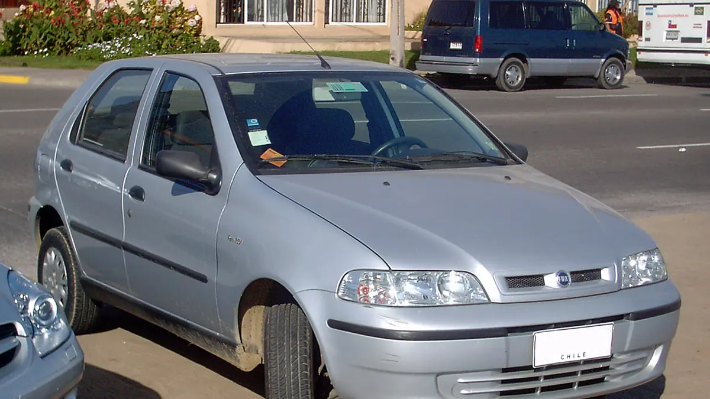
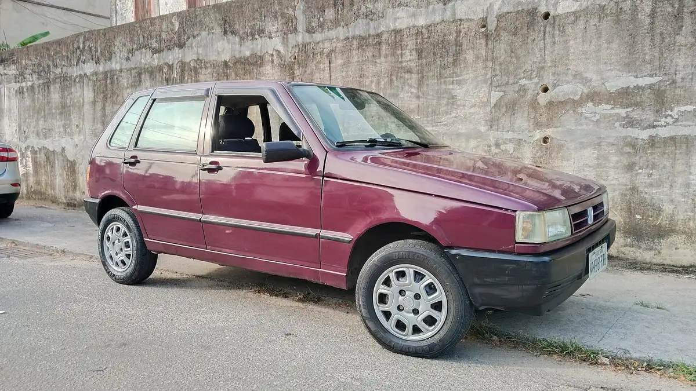
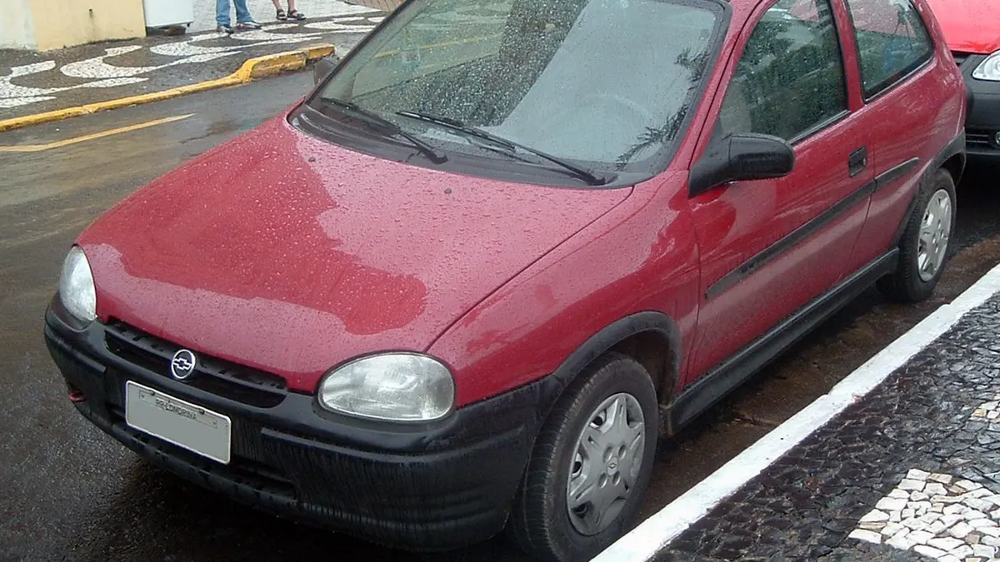
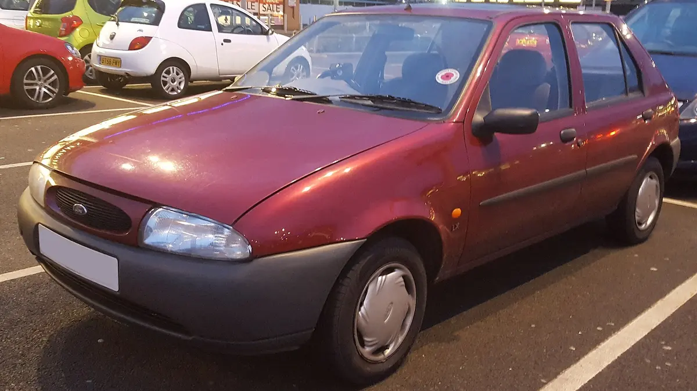
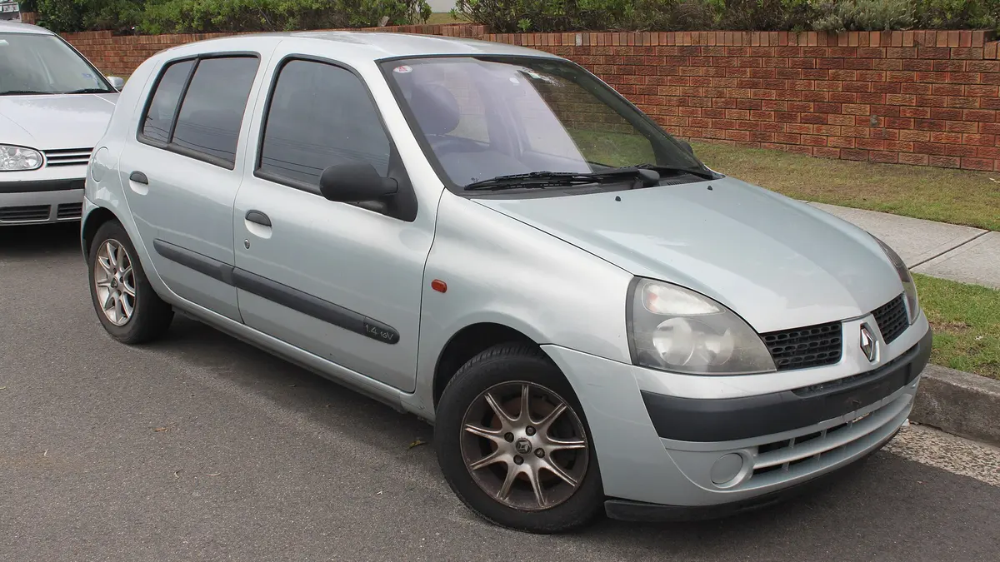

Com **até R$ 15 mil** dá para comprar um carro usado confiável, desde que você escolha bem o modelo, a versão e, principalmente, o exemplar. Os seis desta lista cabem nesse valor pela tabela Fipe de 2026: **Chevrolet Celta, Fiat Palio Fire, Fiat Uno Mille, Chevrolet Corsa Wind, Ford Fiesta Street e Renault Clio 1.6**.

Têm em comum peça barata, mecânica conhecida por qualquer oficina e motores que aguentam muito quilômetro quando bem cuidados.

O outro lado precisa estar claro desde já: são carros de 20 anos ou mais, sem airbag e sem freio ABS, e cada um tem defeitos conhecidos. Abaixo estão as versões certas de cada modelo, a faixa de preço, o que os donos elogiam e reclamam, e onde olhar antes de pagar.

## Como escolhemos os seis

Carro barato de comprar e caro de manter não entra. Os critérios foram:

- **preço na Fipe até R$ 15 mil**, conferido entre agosto e outubro de 2026;
- **peça de reposição fácil e barata**, inclusive em cidade pequena;
- **mecânica simples**, que qualquer oficina conhece;
- **motor com histórico de durabilidade** nos relatos de donos e mecânicos;
- **facilidade de revenda**, para você não ficar preso ao carro depois.

Ficaram de fora modelos que até cabem no preço, mas cobram caro na manutenção ou têm motor problemático. E, dentro de cada modelo, indicamos a versão a evitar.

## Os seis lado a lado

| Carro | Versão e anos indicados | Preço na Fipe (2026) | Destaque |
|---|---|---|---|
| Chevrolet Celta | 1.0, de 2001 a 2005 | R$ 12,5 mil a R$ 15,1 mil | Peça barata e revenda rápida |
| Fiat Palio Fire | 1.0 8V, de 2001 a 2004 | R$ 12 mil a R$ 15,1 mil | Motor Fire, econômico e resistente |
| Fiat Uno Mille | Fire ou injetado antigo, até 2003 | R$ 9,6 mil a R$ 14,7 mil | O mais simples de manter |
| Chevrolet Corsa Wind | 1.0 MPFI, de 1996 em diante | R$ 9,9 mil a R$ 11,4 mil | O mais barato da lista |
| Ford Fiesta Street | 1.0 ou 1.6, de 2002 a 2007 | R$ 9,8 mil a R$ 15,2 mil | Estabilidade e espaço |
| Renault Clio | 1.6 16V hatch, 2002 e 2003 | R$ 12,9 mil a R$ 13,8 mil | O mais forte e bem acabado |

A Fipe é uma referência de preço médio, atualizada todo mês. Carro bem conservado pode valer um pouco mais, e carro maltratado deve sair bem abaixo.

## 1. Chevrolet Celta 1.0 (2001 a 2005)

O Celta é o usado barato mais fácil de revender no Brasil. Vendeu muito, toda oficina conhece e qualquer loja de autopeças tem o que ele precisa. Na faixa de R$ 15 mil, cabem as unidades de 2001 a 2005 de três portas e as de cinco portas até 2004.

**O que os donos elogiam:** o consumo baixo, o seguro barato e a manutenção. Um dono relata ter chegado aos 80 mil km só com revisões preventivas, sem nenhum defeito.

**O que os donos reclamam:** barulho na suspensão, câmbio duro, bancos com pouca espuma e motor barulhento em rotação alta. Na estrada, acima de 100 km/h, o 1.0 trabalha bastante.

**Onde olhar antes de comprar:**

- sinais de superaquecimento, como nível de água baixo, mangueiras ressecadas e óleo com aspecto de maionese na tampa;
- amortecedores e buchas, que costumam pedir troca;
- data da última troca da correia dentada.

## 2. Fiat Palio Fire 1.0 8V (2001 a 2004)

*Foto: order_242, [CC BY-SA 2.0](https://creativecommons.org/licenses/by-sa/2.0), via [Wikimedia Commons](https://commons.wikimedia.org/wiki/File:Fiat_Palio_EX_1.3_Fire_2004_%2812687535155%29.jpg).*

O Palio é maior por dentro que o Uno e mais confortável na estrada, com o mesmo motor Fire, que tem fama de durar. Em R$ 15 mil, cabem as unidades de 2001 a 2004.

**Evite o 1.0 16V.** É a versão que mais aparece nas queixas de oficina e tem manutenção mais delicada que a do 8V. Na dúvida, confira no documento: o 8V é o mais indicado.

**O que os donos elogiam:** o espaço interno, a economia e a robustez do motor Fire.

**O que os donos e reparadores apontam:**

- **eixo traseiro trincado,** a queixa mais citada do Palio, que aparece mesmo sem batida. Olhe embaixo do carro, perto das rodas traseiras;
- **regulagem de válvulas,** que o motor Fire de tuchos mecânicos pede periodicamente e muita gente esquece. O sintoma é barulho de "batida" no motor e consumo maior;
- **arrefecimento e junta do cabeçote,** que sofrem quando o carro superaquece.

## 3. Fiat Uno Mille (Fire ou injetado antigo, até 2003)

*Foto: Cauã Bassin, [CC BY 4.0](https://creativecommons.org/licenses/by/4.0), via [Wikimedia Commons](https://commons.wikimedia.org/wiki/File:Brazilian_Fiat_Uno_-_1999_model-year_-_side_and_front.jpg).*

Se o objetivo é gastar o mínimo possível para andar, o Uno Mille é imbatível. Tanto o Fire quanto o motor antigo já com injeção (as versões EP, SX e Smart, de 1996 a 2001) servem. O Fire é mais econômico e mais moderno. O antigo é ainda mais barato de comprar.

**O que os donos elogiam:** o consumo, com relatos de até 20 km/l no Fire, a resistência e o espaço surpreendente para o tamanho. Um dono resume bem: quase não dá manutenção, e quando dá não é cara.

**O que os donos reclamam:**

- **vazamento de óleo,** a queixa mais comum, pela junta do cárter, tampa de válvulas e retentores;
- amortecedores que pedem troca cedo;
- portas fáceis de arrombar e acabamento simples, com plásticos que batem.

O Uno é o carro mais básico da lista. Não espere conforto acústico nem segurança passiva comparável à de um carro atual.

## 4. Chevrolet Corsa Wind 1.0 MPFI (de 1996 em diante)

*Foto: Renzo Maia, [CC BY 3.0](https://creativecommons.org/licenses/by/3.0), via [Wikimedia Commons](https://commons.wikimedia.org/wiki/File:Brazilian_Chevy_Corsa.jpg).*

O Corsa Wind é o mais barato da lista, na faixa de R$ 10 mil a R$ 11,4 mil. A regra de ouro é escolher a partir de 1996, quando ele trocou a injeção monoponto de 50 cv pela **multiponto (MPFI) de 60 cv**. É mais esperto, mais econômico e tem peças mais fáceis de achar.

**O que os donos elogiam:** economia, com relatos de 16 km/l na estrada, manutenção barata e estabilidade. Um dono de um 1999 diz que o carro "não te deixa na mão".

**O que os donos e mecânicos apontam:**

- **ferrugem nas caixas de roda traseiras e no assoalho,** muitas vezes escondida com massa e tinta. Olhe com lanterna e passe a mão por baixo;
- válvula termostática e superaquecimento;
- buchas da bandeja e pivôs gastos, com estalos em lombadas;
- amortecedores traseiros vazando e direção hidráulica com vazamento, nas versões que têm.

Com o ar-condicionado ligado, o motor 1.0 perde força. Para quem roda muito na cidade com ar, isso pesa.

## 5. Ford Fiesta Street 1.0 ou 1.6 (2002 a 2007)

*Foto: Vauxford, [CC BY-SA 4.0](https://creativecommons.org/licenses/by-sa/4.0), via [Wikimedia Commons](https://commons.wikimedia.org/wiki/File:1997_Ford_Fiesta_1.2_Front.jpg).*

O Fiesta Street é o Fiesta de carroceria antiga, vendido como versão de entrada enquanto o modelo novo já estava nas lojas. Tem o motor Zetec Rocam, conhecido pela durabilidade. Na faixa de R$ 15 mil, cabem o Street 1.0 de 2002 a 2007 e o Street 1.6 de 2002 a 2004.

**Se puder, prefira o 1.6.** Donos do 1.0 reclamam que o carro é pesado para o motor e fraco em subida e ultrapassagem. O 1.6 resolve isso e custa pouco a mais.

**O que os donos elogiam:** estabilidade nas curvas, posição de dirigir e espaço interno.

**O que os donos reclamam:**

- reservatório de água que trinca com facilidade, segundo vários mecânicos ouvidos por donos;
- ruídos internos difíceis de eliminar;
- consumo alto do 1.0 na cidade com ar-condicionado;
- borrachas das portas gastas e suporte do amortecedor no porta-malas.

## 6. Renault Clio 1.6 16V hatch (2002 e 2003)

*Foto: Jeremy from Sydney, [CC BY 2.0](https://creativecommons.org/licenses/by/2.0), via [Wikimedia Commons](https://commons.wikimedia.org/wiki/File:2001-2004_Renault_Clio_%28X65_Phase_2%29_Expression_5-door_hatchback_%2824035818636%29.jpg).*

O Clio 1.6 16V é o mais forte e o mais bem acabado da lista. O motor anda bem, e um dono com 170 mil km relata painel sem um ruído. Na faixa de R$ 15 mil, cabem os hatch 1.6 de 2002 e 2003. O 2004 já passa de R$ 16 mil na Fipe.

Um ponto a favor dessa faixa de anos: a falha do sistema flex, que reparadores citam nos Clio 1.6 a partir de 2005, não existe aqui, porque esses são a gasolina.

**O que os donos elogiam:** desempenho, economia para um 1.6 e durabilidade com manutenção em dia. Um dono resume: troque óleo e filtros no prazo e pode andar sem medo.

**O que os donos e reparadores apontam:**

- **bobinas e cabos de vela,** que dão falha e têm peça mais cara que a dos concorrentes;
- **aterramentos dos sensores,** que causam defeitos elétricos difíceis de achar;
- **troca da correia dentada** mais trabalhosa, pelo pouco espaço no motor 16V. Exija a nota da última troca;
- peças em geral mais caras que as de Celta, Palio e Uno.

O Clio é a escolha de quem quer mais carro pelo mesmo dinheiro e aceita gastar um pouco mais na oficina.

## IPVA quase zero: a vantagem escondida

Desde a Emenda Constitucional 137/2025, carro de passeio com 20 anos ou mais de fabricação não paga IPVA em nenhum estado. Em 2026, isso vale para os fabricados até 2005, ou seja, para a maioria dos carros desta lista. O detalhe completo está em [quem tem isenção de IPVA](/ipva-licenciamento/isencao-de-ipva-quem-tem-direito/).

A conta é pela data de fabricação, que aparece no documento do carro. Um Celta fabricado em 2005 com modelo 2006 já é isento em 2026. A taxa de licenciamento anual continua sendo cobrada.

## O que esses carros não têm

Nenhum dos seis tem airbag ou freio ABS de série nas versões indicadas. Os dois itens só se tornaram obrigatórios em todos os carros novos vendidos no Brasil a partir de 2014, pela Lei 11.910/2009 e pelas resoluções do Contran que a regulamentaram.

Isso não impede ninguém de comprar, mas muda o jeito de usar: pneus em bom estado, freios revisados e velocidade compatível com um carro de 20 anos. A [calibragem correta dos pneus](/manutencao-do-carro/calibragem-pneu-pressao-correta/) e a revisão dos freios fazem mais diferença aqui que num carro novo.

## Antes de pagar: o checklist do carro de 20 anos

Num carro dessa idade, o histórico de cada exemplar importa mais que o modelo. Antes de fechar negócio:

1. **Consulte a placa** no Detran: débitos, multas, restrições e registro de roubo. O passo a passo está em [consulta de débitos do veículo pela placa](/documentacao-do-veiculo/consulta-debitos-veiculo-pela-placa/).
2. **Consulte o recall** pelo chassi no portal do governo. Recall pendente pode travar o licenciamento.
3. **Veja o carro frio,** de preferência pela manhã. Motor que já chega quente pode esconder falha na partida.
4. **Leve um mecânico de confiança** e coloque o carro no elevador: ferrugem, vazamentos, eixo traseiro, suspensão e escapamento.
5. **Teste na rua por pelo menos 15 minutos,** com ar ligado, em subida e com o carro esquentando, de olho no marcador de temperatura.
6. **Peça as notas de manutenção,** principalmente da correia dentada e da última troca de óleo. Os sinais de óleo vencido estão em [quando trocar o óleo do carro](/manutencao-do-carro/quando-trocar-oleo-do-carro/).
7. **Guarde uma reserva para a primeira revisão.** Nossa recomendação é separar algo entre 10% e 15% do valor do carro: correia, fluidos, filtros e itens de suspensão quase sempre precisam de algo.
8. **Faça a transferência no prazo de 30 dias,** como mostramos em [como transferir um carro usado](/documentacao-do-veiculo/como-transferir-carro-usado/).

<Faq items={frontmatter.faq} />

## Qual escolher

Para gastar o mínimo e revender fácil, fique com o **Celta** ou o **Uno Mille**. Para mais espaço com o mesmo custo, o **Palio Fire 8V**. Para pagar menos na compra, o **Corsa Wind MPFI**. Para quem roda em estrada, o **Fiesta Street 1.6**. E, para quem quer mais carro e aceita uma oficina um pouco mais cara, o **Clio 1.6**.

Em qualquer um deles, o melhor negócio é o exemplar com dono que mostra as notas, não o mais barato do anúncio. Pague um pouco mais por um carro bem cuidado e guarde a diferença para a primeira revisão.
